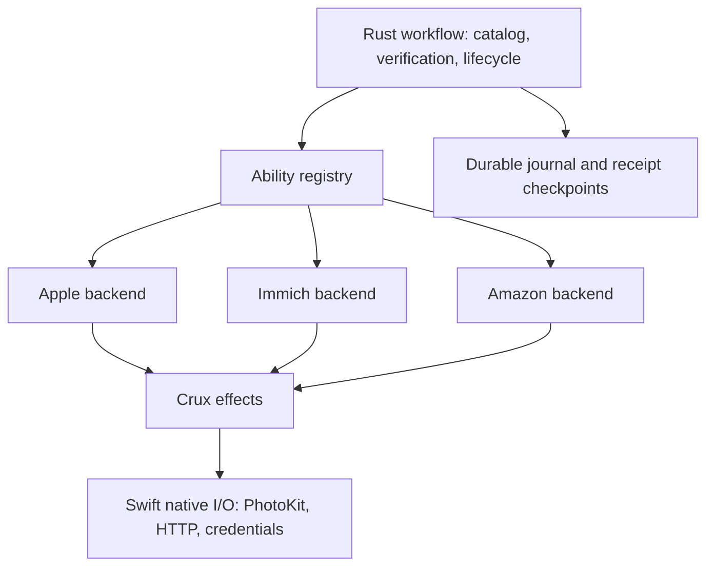
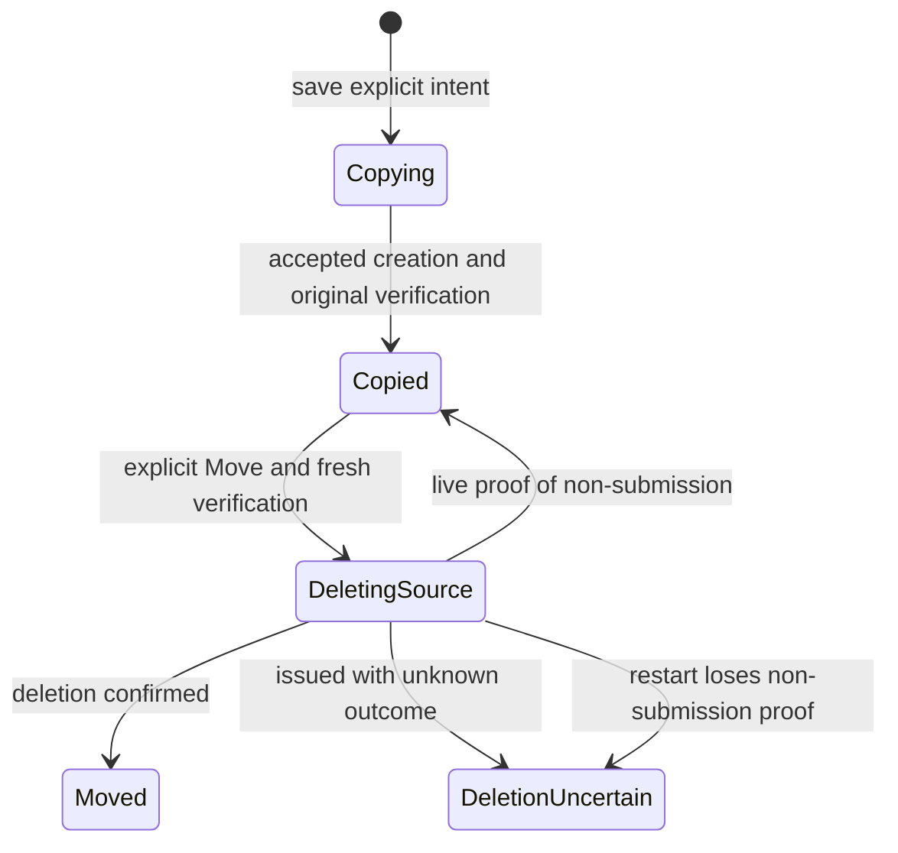

# Provider abilities and transfer lifecycle

Rust selects operations by ability. Each connected service has one immutable
backend value implementing its supported traits. `Registry` resolves a provider
to `Option<&dyn Ability>`; connection absence and unsupported abilities remain
distinct. Unsupported operations fail before native effects.

The workflow owns catalog changes, operation authorization, original verification
and saved journals. Album reading, creation and editing have independent traits;
`Abilities` can register real or fake implementations independently. A backend receives an operation-scoped read port and a narrow
journal port for imports. It does not receive mutable `SavedLibrary`. Swift still
executes PhotoKit, HTTP, WebKit and Keychain effects; it does not implement the
transfer state machine or construct service routes. HTTP transport types are in
`transport.rs`, with compatibility re-exports from `immich.rs`.

Immich's progressive refresh keeps visibility reconciliation and partial-view
publication in the workflow. It shares `hydrate_immich` with the listing backend;
that specialized orchestration does not delegate catalog/journal policy to an
adapter. Rendition and private-media paths retain their existing contracts.

Creation returns destination identities. It does not certify a complete copy.
Only shared verification of a fresh original readback can publish `Copied`.
Previews remain on their existing independent rendition/FFI path; they do not
dispatch through this transfer registry and cannot satisfy its original-byte
contract. A limited
selection is explicitly distinct from an inventory of the whole library and
cannot establish absence outside that selection.

## Transfer protocol

`transfer_lifecycle.rs` contains the pure receipt transition rules. The workflow
executes their effects and awaits persistence before native mutation. The saved
format and its Copy default for legacy receipts stay compatible.

`DeletingSource` must be durable before the delete effect. After restart no
volatile authority or old native callback can reauthorize deletion. An unknown
result remains blocked rather than retried. The block applies to the full source
key across other receipts as well; a new receipt ID cannot bypass it. Normal Copy
remains available, and other provider/account scopes stay independent. Failure before submission may only
restore a retryable state when the current execution proves no native request
was sent; durable phase alone cannot prove that fact.

Amazon continues to offer copy rather than Move because its original/metadata
preservation contract does not yet authorize source deletion. Unsupported Amazon
file formats continue to stop the transfer and explain an alternative storage
choice; original bytes are never silently converted.

Immich Move deletion uses a dedicated `HttpDeletion` effect. Swift checks the
original workflow context, captures a short-lived shared submission permit and
rechecks that permit under a lock when resuming the HTTP task. Observed Apple or
protection changes revoke it. A refusal reported after dispatch remains
conservatively uncertain; it cannot mint proof that deletion was never submitted.

## Verification and limits

See [`formal/README.md`](../formal/README.md) for the Quint/TLA+/TLC model,
assumptions, mutation controls and mapping to actual effects. `make check` includes
its finite exhaustive safety check; neither model checking nor offline mocks
establish real service or PhotoKit acceptance. Native execution and hosted CI are
reported separately.

A new service or mock implements the abilities it actually supplies. Google
Photos is not implemented by this refactoring. Its selection-only inventory and
app-created-only mutation constraints must be represented explicitly when added;
it must not inherit a full-library or general deletion promise from another
backend.
